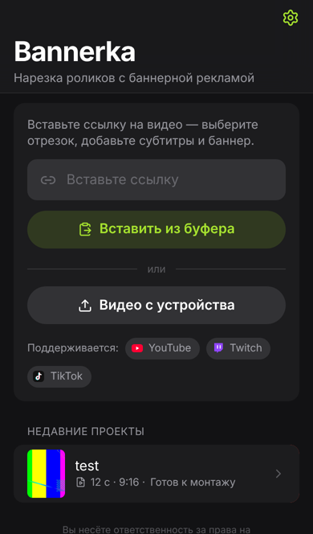
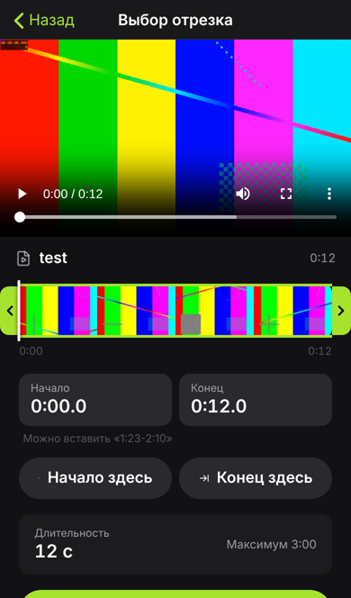
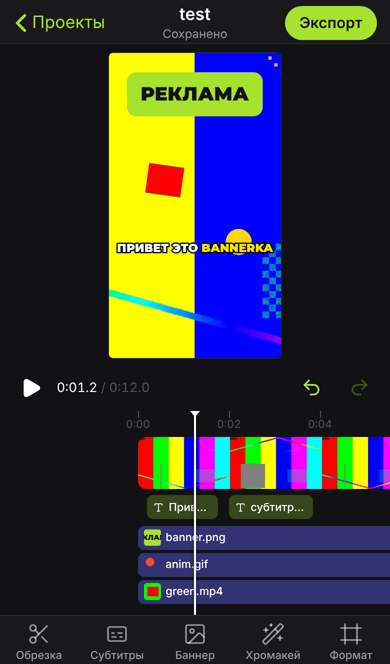
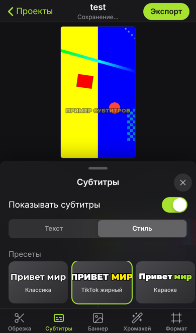
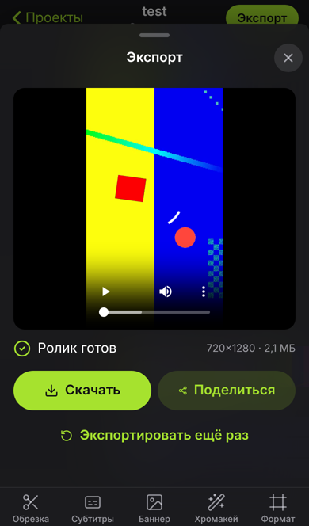
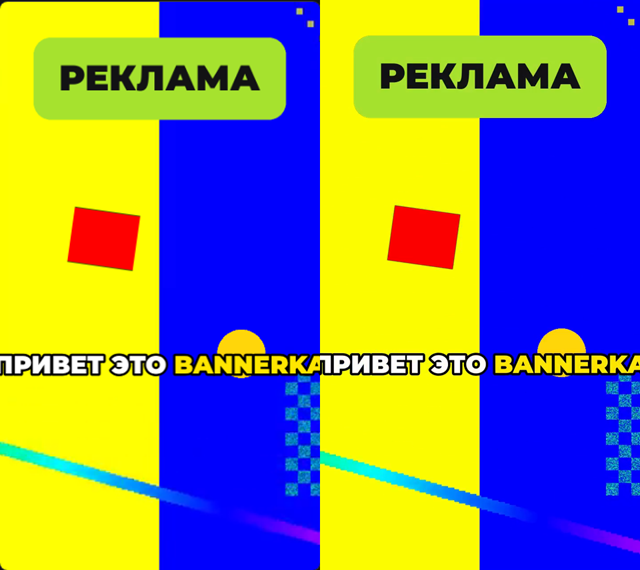

# Bannerka

**Bannerka** — веб-приложение (PWA) для быстрой нарезки роликов из YouTube, Twitch и TikTok
и вставки в них баннерной рекламы. Выглядит и работает как нативный видеоредактор на iPhone
(Apple HIG), ставится на экран «Домой» и открывается без браузерного интерфейса.

<p>
  
  
  
  
  
</p>

## Возможности

- **Ссылка → отрезок.** YouTube (видео, Shorts), Twitch (VOD, клипы), TikTok — или видео с устройства.
  Двойной ползунок поверх раскадровки, таймкоды `мм:сс` / `чч:мм:сс`, вставка `1:23-2:10`,
  «Начало здесь / Конец здесь» по позиции плеера, лимит длины (по умолчанию 3 минуты).
  Сервер скачивает **только выбранный фрагмент** (`yt-dlp --download-sections`).
- **Редактор.** Превью кадра в выбранном формате (9:16, 16:9, 1:1, 4:5; «заполнить / вписать»,
  перемещение и масштаб видео пальцами), таймлайн с кадрами и неподвижным плейхедом,
  pinch-zoom таймлайна, тримминг краёв, разделение и удаление кусков, дорожки субтитров и баннеров,
  undo / redo, автосохранение.
- **Субтитры.** faster-whisper с таймингами по словам, автоопределение или выбор языка; правка строк,
  разбиение / склейка, сдвиг, удаление; 6 пресетов и полная настройка стиля (10 шрифтов с кириллицей,
  размер, насыщенность, цвет, обводка, тень, плашка со скруглением, позиция с перетаскиванием,
  слов на экране, регистр, анимации появления, караоке-подсветка, «pop» текущего слова).
- **Баннеры.** PNG / JPG / WebP / GIF / MP4 / WebM / MOV до 50 МБ, библиотека для повторного
  использования, перетаскивание / щипок / поворот / прозрачность, пресеты позиций, время показа
  на таймлайне, анимации входа и выхода (растворение, выезд с любой стороны, масштаб), несколько баннеров.
- **Хромакей.** Для видео-баннеров и основного видео: пипетка по превью, схожесть, сглаживание,
  подавление ореола. Превью — WebGL-шейдер, экспорт — ffmpeg `chromakey` + `despill` с той же математикой.
- **Экспорт.** 720p / 1080p, исходная / 30 / 60 fps, MP4 (H.264 + AAC). Рендер в фоне с прогрессом
  через SSE, можно закрыть экран — по готовности придёт тост; «Скачать» и «Поделиться» (Web Share API).
- **PWA.** Манифест, иконки (в том числе maskable), `apple-touch-icon`, splash-экраны для iPhone,
  service worker с кэшем оболочки, онбординг «На экран „Домой“» (iOS — пошаговая инструкция,
  Android / Chrome — `beforeinstallprompt`), тёмная (основная) и светлая темы.

## Превью = экспорт

Рендер на сервере строится **только** из JSON проекта, а превью в браузере повторяет ту же математику:

| Что | Превью (браузер) | Экспорт (сервер) |
| --- | --- | --- |
| Геометрия кадра, видео, баннеры | `frontend/src/lib/geometry.ts` | `backend/app/render/graph.py` |
| Таймлайн, куски, страницы субтитров | `frontend/src/lib/timeline.ts` | `backend/app/render/timeline.py` |
| Субтитры | canvas, `editor/subtitles/renderSubtitles.ts` | ASS + libass, `render/ass.py` |
| Хромакей | WebGL, `editor/chroma/shader.ts` | `chromakey` + `despill`, `graph.py` |

Субтитры рисуются **теми же файлами шрифтов** (`frontend/public/fonts`, их готовит
`scripts/fetch_fonts.py`: уникальные внутренние имена и вертикальные метрики, нормализованные под libass).
Общие фикстуры `shared/fixtures/timeline.json` проверяются и pytest, и vitest.

Калибровка совпадения: `scripts/parity/run.sh` рендерит одни и те же кадры браузером (Playwright)
и ffmpeg и сравнивает их. Текущий результат (720×1280):

```
subtitles (canvas vs libass)          chroma key (WebGL vs ffmpeg)
  ✓ outline  bbox Δ ≤ 1 px, 0.24%       ✓ soft   mean |Δalpha| 0.02/255
  ✓ box      bbox Δ 0 px,   0.00%       ✓ hard   mean |Δalpha| 0.00/255
  ✓ shadow   bbox Δ ≤ 1 px, 0.17%       ✓ spill  mean |Δalpha| 0.05/255
  ✓ fit      bbox Δ ≤ 3 px, 0.48%
  ✓ oswald   bbox Δ ≤ 1 px, 0.07%
```



## Быстрый старт (Docker)

```bash
cp .env.example .env
docker compose up -d --build      # или: make up
open http://localhost:8080
```

Поднимаются четыре контейнера: `web` (nginx: PWA, прокси API, раздача файлов через `X-Accel-Redirect`),
`api` (FastAPI), `worker` (arq: скачивание, транскрипция, рендер, очистка) и `redis`.
Данные (SQLite, медиа, модель Whisper) лежат в томе `storage`.

Модель faster-whisper (`WHISPER_MODEL`, по умолчанию `small`) скачивается с Hugging Face при первой
транскрипции; заранее — `make whisper-model`. Без субтитров образ можно собрать меньше: `WITH_WHISPER=0`.

## Деплой на VPS (HTTPS)

PWA и service worker работают только по HTTPS.

1. В `.env`: `WEB_PORT=127.0.0.1:8080`, `COOKIE_SECURE=true`.
2. `docker compose up -d --build`.
3. Внешний nginx + Let's Encrypt — пример в [`deploy/nginx.vps.conf`](deploy/nginx.vps.conf):
   `sudo certbot --nginx -d bannerka.example.com`.
4. Обновлять yt-dlp регулярно: платформы часто меняются — `make update-ytdlp`.
   Для видео с проверкой «вы не бот» / возрастом можно передать cookies: `YTDLP_COOKIES_FILE`.

## Локальная разработка

Нужны Python 3.12, Node 20+, ffmpeg и redis-server.

```bash
make dev        # Redis + API (reload) + worker + Vite → http://localhost:5173
make test       # pytest + vitest
make lint       # ruff + tsc
```

API-документация: http://localhost:8000/api/docs.

## Конфигурация

Все параметры — переменные окружения (см. [`.env.example`](.env.example)):

| Переменная | По умолчанию | Назначение |
| --- | --- | --- |
| `MAX_CLIP_SECONDS` | `180` | максимальная длина выбранного отрезка |
| `MAX_BANNER_MB` / `MAX_UPLOAD_MB` | `50` / `1024` | лимиты загрузки баннера / видео |
| `MAX_ACTIVE_JOBS_PER_SESSION` | `3` | параллельные задачи на сессию |
| `RATE_LIMIT_PER_MINUTE` | `240` | запросов к API в минуту на сессию |
| `FILE_TTL_HOURS` / `ASSET_TTL_HOURS` | `24` / `168` | автоочистка проектов и файлов / библиотеки баннеров |
| `DEFAULT_QUALITY` / `MAX_QUALITY` | `1080` / `2160` | качество фрагмента по умолчанию / лучшее, которое можно выбрать |
| `PROXY_SHORT_SIDE` | `540` | прокси для превью в редакторе |
| `WHISPER_MODEL`, `WHISPER_DEVICE`, `WHISPER_COMPUTE_TYPE` | `small`, `cpu`, `int8` | распознавание речи |
| `RENDER_PRESET`, `WORKER_MAX_JOBS` | `veryfast`, `2` | скорость рендера и параллелизм воркера |
| `COOKIE_SECURE`, `X_ACCEL_REDIRECT` | `false`, `false` (в compose `true`) | HTTPS-cookie, отдача файлов nginx'ом |

## Архитектура

```
iPhone / браузер (PWA, React + Zustand)
        │  HTTPS
        ▼
nginx (web) ── статика, SW, X-Accel-Redirect ──► том storage
        │ /api
        ▼
FastAPI (api) ── SQLite (проекты, медиа, задачи, сессии) ── Redis (очередь arq, прогресс pub/sub, rate limit)
                                                              │
                                                              ▼
                                       arq worker: yt-dlp · ffmpeg · faster-whisper · очистка
```

- **Сессии** анонимные (httpOnly-cookie), проекты и библиотека баннеров привязаны к ней.
- **Задачи**: `download`, `preview` (TikTok, клипы Twitch, загрузки), `strip` (раскадровка длинных VOD),
  `transcribe`, `render`, `asset`. Прогресс: `GET /api/jobs/{id}/events` (SSE; при обрыве — опрос).
- **Файлы** отдаются по случайным id: `/api/media/{id}` (inline, Range) и `/api/files/{id}` (скачивание).

Основные эндпоинты: `POST /api/source/resolve`, `POST /api/source/preview`, `POST /api/source/upload`,
`POST /api/projects`, `GET|PATCH|DELETE /api/projects/{id}`, `GET /api/projects/{id}/thumbnails`,
`POST /api/projects/{id}/transcribe`, `POST /api/projects/{id}/render`, `POST|GET|DELETE /api/assets`,
`GET /api/jobs/{id}`, `GET /api/jobs/{id}/events`, `POST /api/jobs/{id}/cancel`, `GET /api/files/{id}`.

## Безопасность

- Ссылки — только из белого списка доменов, нормализуются и передаются в yt-dlp после `--`.
- В ffmpeg / yt-dlp не попадают пользовательские строки: только числа, проверенные схемой
  (Pydantic), и пути, созданные приложением.
- Загрузки проверяются по сигнатурам файлов (не по заголовку `Content-Type`), с лимитом размера.
- Файлы — по неугадываемым id; проекты, задачи и баннеры доступны только своей сессии; rate limit на API.

## Тесты

```bash
cd backend && python -m pytest -q     # 119 тестов: таймкоды, ссылки, ffmpeg-граф, ASS, API, воркер с ffmpeg
cd frontend && npm test               # vitest: таймлайн (общие фикстуры), таймкоды, геометрия, правка субтитров
./scripts/parity/run.sh               # калибровка превью = экспорт (нужны dev-сервер и playwright)
```

## Права на контент

Пользователь сам отвечает за права на используемый контент (видео, музыку, изображения баннеров)
и за соблюдение правил платформ (YouTube, Twitch, TikTok). Bannerka — инструмент монтажа и не
предоставляет прав на чужие материалы.

Решения, принятые по ходу разработки, — в [`DECISIONS.md`](DECISIONS.md).
